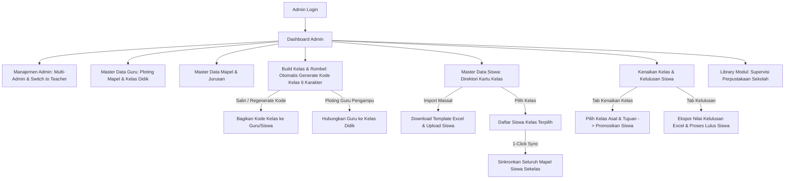
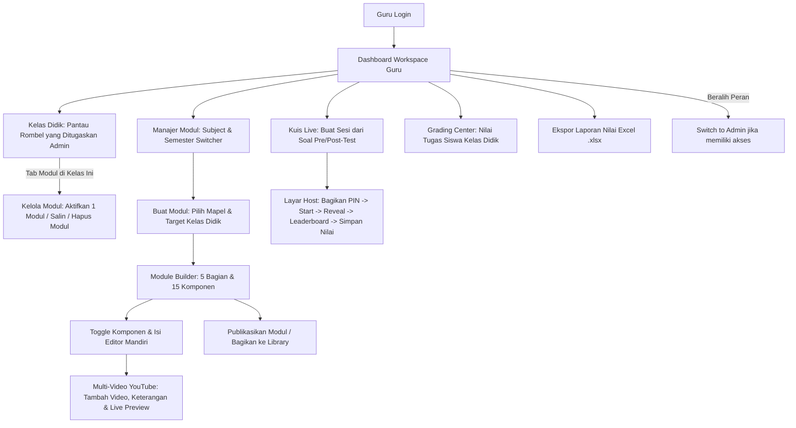
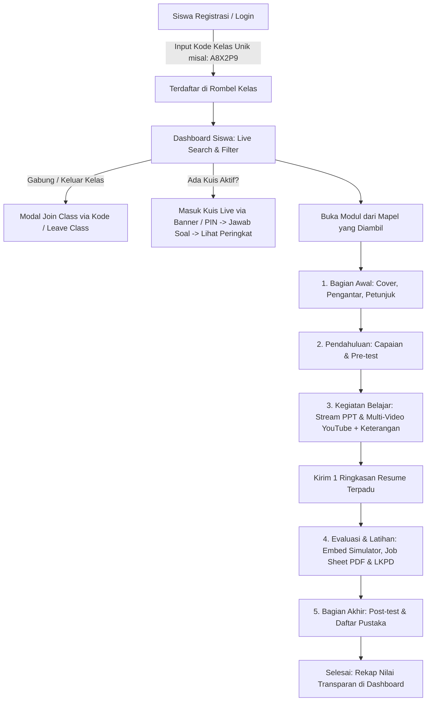
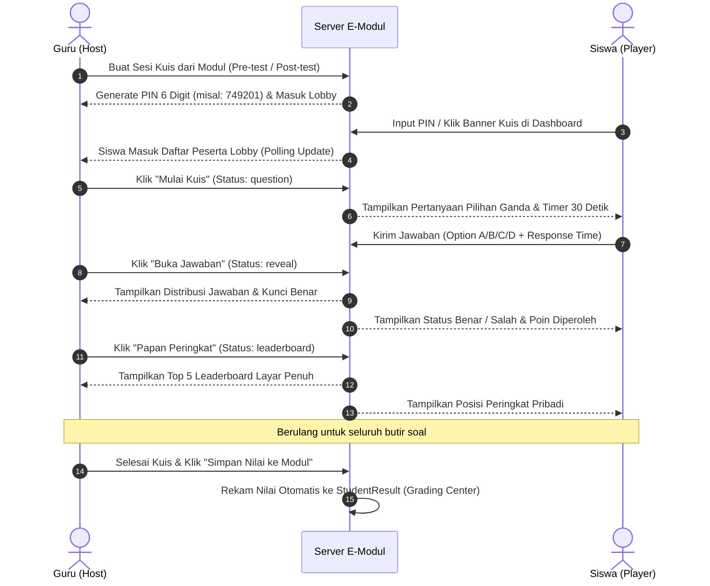
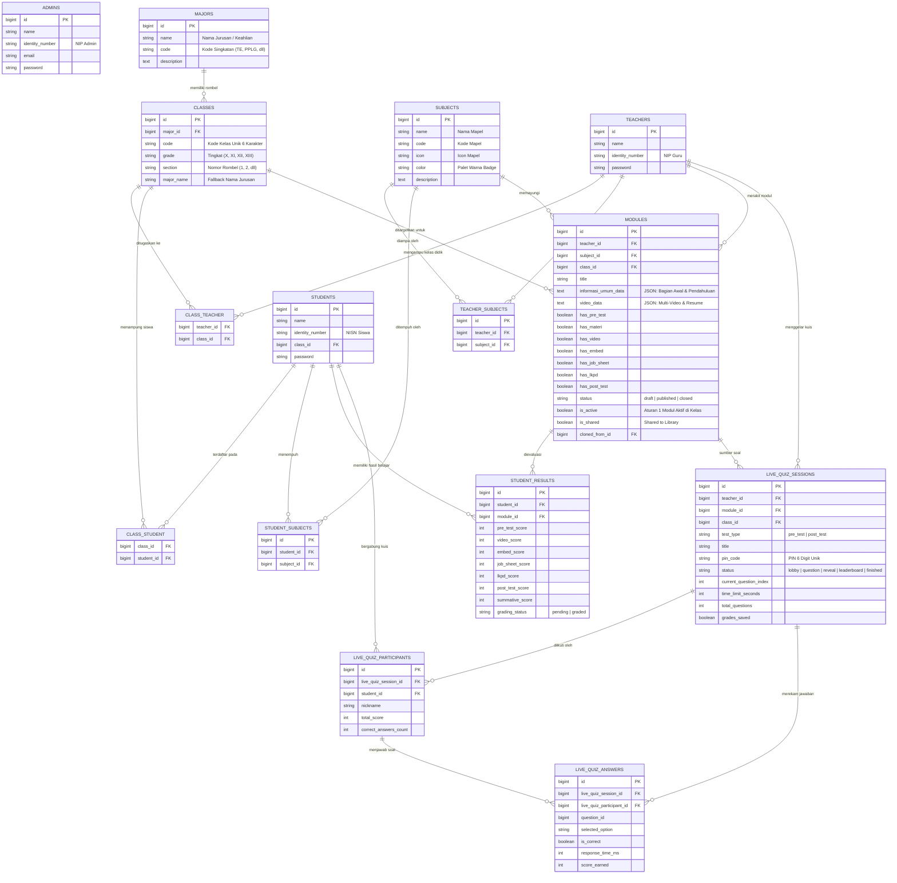

# PRD — Project Requirements Document “Pengembangan CMS E-Modul Berbasis Web dengan Laravel 11 untuk Pengelolaan Materi dan Evaluasi Pembelajaran di SMK Negeri 3 Yogyakarta” 

---

## 1. **Overview (Tinjauan Umum)**

### 1.1 Latar Belakang Proyek

Aplikasi ini merupakan platform *Content Management System* (CMS) E-Modul berbasis web yang dirancang secara esensial untuk mendukung dan mengoptimalkan ekosistem pendidikan vokasi di **SMK Negeri 3 Yogyakarta**.

Pengembangan platform ini dilatarbelakangi oleh beberapa kondisi nyata dalam proses belajar mengajar di sekolah:

1. **Fragmentasi Instrumen & Media Pembelajaran:**  
   Penggunaan instrumen dan media pembelajaran sebelumnya masih terpisah-pisah di berbagai platform pihak ketiga. Sebagai contoh, guru menggunakan formulir daring (seperti Google Forms) untuk pelaksanaan *pre-test*, membagikan Lembar Kerja Peserta Didik (LKPD) berformat dokumen Word melalui tautan unduhan terpisah, serta menginstruksikan pengumpulan tugas melalui platform lain. Kerumitan berpindah-pindah tautan ini menyita banyak waktu efektif pembelajaran dan membingungkan siswa.

2. **Karakteristik Pembelajaran Sistem Blok & Ketiadaan Repositori Terpusat:**  
   Materi yang disampaikan di kelas sering kali tidak terdokumentasi dan tersimpan secara terpusat, sehingga menyulitkan siswa untuk melakukan pembelajaran mandiri atau mengulang materi (*review*). Kondisi ini menjadi semakin kritis mengingat alokasi waktu mata pelajaran tertentu (seperti Informatika atau Kejuruan Teknik) menerapkan sistem pembelajaran blok intensif—mencapai 8 jam pelajaran dalam satu hari dan diselesaikan dalam rentang waktu singkat (2 minggu / 14 hari). Siswa sangat rentan melupakan konsep dan keterampilan praktis yang telah dipelajari jika tidak memiliki akses modul digital yang terstruktur dan dapat diakses setiap saat.

3. **Beban Administrasi Guru dalam Monitoring & Evaluasi:**  
   Fragmentasi platform menyita waktu manajemen kelas dan menyulitkan pendidik dalam memantau rekam jejak kognitif maupun progres belajar siswa secara utuh. Proses rekapitulasi nilai menjadi tidak efisien karena guru harus membuka dan menggabungkan data dari berbagai aplikasi yang berbeda.

4. **Kebutuhan Evaluasi Interaktif Real-Time di Kelas:**  
   Pembelajaran di kelas membutuhkan sesi evaluasi yang memicu antusiasme siswa secara serentak (gamifikasi pembelajaran). Keterbatasan fitur kuis langsung pada LMS konvensional mendorong perlunya modul kuis langsung interaktif (*live quiz*) berbasis PIN tanpa harus mengandalkan lisensi pihak ketiga berbayar.

5. **Kebutuhan Siklus Akademik Berkelanjutan (Kenaikan Kelas & Kelulusan):**  
   Manajemen kurikulum sekolah memerlukan otomatisasi saat pergantian tahun ajaran baru, meliputi kenaikan kelas berjenjang (*promotion*), sinkronisasi mata pelajaran tingkat baru, serta pengarsipan data dan pelaporan kelulusan siswa tingkat akhir (*graduation*).

Berdasarkan permasalahan tersebut, platform E-Modul ini dibangun menggunakan kerangka kerja **Laravel 11** dengan sistem kontrol akses multi-peran (**Admin**, **Guru**, dan **Siswa**). Platform ini hadir sebagai solusi satu pintu (*one-stop solution*) yang mempermudah guru dalam menyusun materi terstruktur serta mengelola penilaian secara komprehensif, sekaligus memberikan pengalaman belajar yang terarah, interaktif, dan mudah diakses kapan saja oleh siswa.

---

### 1.2 Pernyataan Masalah (Problem Statement)

Pengembangan platform ini diinisiasi untuk memecahkan masalah utama (*pain points*) yang dialami oleh pemangku kepentingan di sekolah:

- **Kendala Guru:** Pengelolaan materi dan penilaian saat ini terpencar. Guru sering kali merasa dibatasi oleh *template* modul digital yang kaku. Selain itu, seorang guru kejuruan sering kali mengampu lebih dari satu mata pelajaran sekaligus (misal: Informatika dan Teknik Elektro) dan memiliki beberapa rombongan belajar kelas tanggung jawab mengajar (**Kelas Didik**). Dibutuhkan sebuah sistem *builder* yang modular, terstruktur sesuai 5 Bagian Utama E-Modul, mendukung integrasi multimedia multi-video YouTube, isolasi kelas didik yang bersih tanpa terganggu kelas lain di sekolah, aturan satu modul aktif di kelas agar siswa fokus, arena kuis langsung interaktif (*Live Quiz*), fitur duplikasi/salin modul antar kelas, dan *Subject Switcher* terintegrasi.
- **Kendala Siswa:** Siswa sering mengalami disorientasi jika materi disajikan dalam satu halaman panjang tak berujung (*scroll* panjang) atau jika dashboard dipenuhi modul mata pelajaran yang tidak mereka tempuh. Siswa membutuhkan modul digital yang terbagi ke dalam tahapan sistematis (Bagian Awal, Pendahuluan, Kegiatan Belajar, Evaluasi & Latihan, hingga Bagian Akhir), pencarian & filter instan modul yang efisien di dashboard, pemutar video interaktif dengan daftar putar, kemudahan bergabung atau keluar kelas via Kode Kelas unik, partisipasi kuis langsung berbasis PIN, serta transparansi penilaian hasil belajar.
- **Kendala Manajemen Sekolah (Admin & Kurikulum):** Pihak kurikulum memerlukan panel administrasi terpadu untuk mengelola Master Data Pengguna (Guru & Siswa), Master Kurikulum (Mata Pelajaran & Jurusan/Konsentrasi Keahlian), **Sentralisasi Build Rombongan Belajar Kelas dengan Kode Kelas Unik Otomatis**, penugasan Kelas Didik & Mapel bagi guru, import data siswa massal via Excel (.xlsx), sinkronisasi massal mapel kelas, pergantian tahun ajaran (Kenaikan Kelas & Kelulusan Siswa), manajemen multi-admin dengan *dual-role switcher*, serta supervisi mutu perpustakaan modul dari seluruh guru.

---

### 1.3 Tujuan Utama (Objectives)

Tujuan dari proyek ini adalah membangun portal E-Modul terpusat berbasis **Laravel 11** dengan sistem manajemen akses multi-peran (**Admin**, **Guru**, dan **Siswa**).

Sistem ini ditargetkan:
1. Memberikan fasilitas *E-Module Builder* bagi guru untuk merakit materi secara terstruktur menjadi **5 Bagian Utama Standar E-Modul (15 Komponen Fleksibel)**:
   - **1. Bagian Awal (4 Komponen):** Cover modul, kata pengantar, daftar isi, dan petunjuk penggunaan bagi siswa & guru (`BagianAwalController`).
   - **2. Pendahuluan (4 Komponen):** Rumusan tujuan pembelajaran & capaian, peta konsep alur materi, glosarium istilah (`PendahuluanController`), serta soal latihan diagnostik / Pre-test (`PreTestController`).
   - **3. Kegiatan Belajar / Isi Materi (2 Komponen):** Uraian materi pembelajaran teks & presentasi PPT (`MateriController`), serta integrasi multimedia **Multi-Video YouTube & Keterangan Video dengan Satu Ringkasan Terpadu** (`VideoController`).
   - **4. Evaluasi & Latihan (3 Komponen):** Game edukasi interaktif & media embed simulator (`EmbedController`), lembar kerja praktik / *Job Sheet* PDF (`JobSheetController`), serta tugas lembar kerja peserta didik & umpan balik / LKPD (`LkpdController`).
   - **5. Bagian Akhir (2 Komponen):** Tes akhir modul / Post-test (`PostTestController`), dan daftar pustaka kepustakaan & rujukan (`DaftarPustakaController`).
2. Menyediakan **Panel Administrasi Master Data & Build Kelas Terpadu** bagi Admin untuk mengelola akun guru, akun siswa per rombel kelas, master mata pelajaran, master jurusan / konsentrasi keahlian, serta membangun rombongan belajar kelas dengan **Generator Kode Unik Kelas Otomatis (6 Karakter Kapital)**.
3. Menyediakan **Fasilitas Import Siswa Massal via Spreadsheet Excel (.xlsx)** lengkap dengan template unduhan resmi dan fitur **Sinkronisasi Seluruh Mata Pelajaran Kelas (1-Click Sync)**.
4. Menyediakan **Manajemen Siklus Akademik (Kenaikan Kelas & Kelulusan Siswa)** untuk mengelola promosi rombel siswa antar-tingkat (X &rarr; XI &rarr; XII &rarr; XIII), otomatisasi penyesuaian mata pelajaran di tingkat baru, proses kelulusan siswa tingkat akhir, serta ekspor laporan kelulusan format Excel.
5. Menyediakan **Manajemen Multi-Administrator & Dual-Role Switching**, memungkinkan konversi akun Guru &harr; Admin dan transisi instan antar peran (*Switch to Teacher* / *Switch to Admin*) tanpa perlu *logout* dan *login* ulang.
6. Menyediakan **Kuis Live Interaktif (*Interactive Live Quiz Arena*) ala Kahoot/Quizizz**:
   - Guru dapat meluncurkan kuis langsung berbasis bank soal modul (Pre-test atau Post-test) dengan PIN 6 digit unik.
   - Arena Host layar penuh dengan kontrol alur kuis (*Start*, *Reveal Answer*, *Live Leaderboard*, *Next Question*, *Finish*).
   - Siswa bergabung dari dashboard/portal, menjawab soal berbatas waktu, dan melihat skor serta peringkat secara langsung.
   - Sinkronisasi hasil nilai kuis live langsung ke buku nilai / Grading Center modul terkait (`saveGrades`).
7. Menerapkan **Aturan Satu Modul Aktif per Rombel Kelas (`is_active`)**: Setiap kali sebuah modul diaktifkan di suatu kelas, seluruh modul lain di kelas tersebut otomatis dinonaktifkan agar siswa fokus pada materi yang sedang diajarkan.
8. Menyediakan **Fitur Salin Modul & Tombol Hapus Modul di Kelas Ini**: Guru dapat mengimpor/menduplikasi modul dari kelas lain ke kelas aktif serta menghapus modul langsung dari tab "Modul di Kelas Ini" dengan konfirmasi keamanan cascade data dan *auto-redirect*.
9. Menerapkan **Fitur Gabung Kelas (Join Class) & Keluar Kelas (Leave Class)** mandiri bagi siswa berbasis Kode Kelas unik dengan perlindungan penghapusan data nilai lokal kelas yang aman.
10. Menyediakan **Library Modul (Repositori Kolaboratif Antar-Guru)** untuk saling berbagi dan menduplikasi (*deep clone*) instrumen pembelajaran digital.
11. Memfasilitasi guru dengan **Grading Center Adaptif** dan **Ekspor Spreadsheet Excel (.xlsx)** yang dinamis menyesuaikan komponen aktif pada modul.
12. Mengintegrasikan **Manajemen Multi-Tanggung Jawab Guru**, memungkinkan seorang guru mengampu 2 atau lebih mata pelajaran dengan *Subject Switcher* pada seluruh menu guru.

---

### 1.4 Ruang Lingkup Proyek (Scope of Work)

Untuk fase rilis operasional, ruang lingkup aplikasi mencakup:

- **Multi-Guard Access:** Admin (Supervisi & Master Data), Guru (Pendidik & Kreator Modul), dan Siswa (Peserta Didik).
- **Sentralisasi Build Kelas di Admin:** Pembuatan, pengeditan, dan penghapusan rombel kelas dikelola terpusat oleh Admin dengan otomatisasi kode unik kelas.
- **Import Massal Siswa via Excel (.xlsx):** Pendaftaran ratusan siswa sekaligus per kelas melalui pengunggahan berkas spreadsheet.
- **Kenaikan Kelas & Kelulusan (Tahun Ajaran Baru):** Manajemen promosi siswa dan kelulusan dengan penyesuaian kurikulum otomatis.
- **Isolasi Kelas Didik Guru:** Guru hanya mengakses rombel kelas yang ditugaskan oleh Admin kepadanya.
- **Aturan 1 Modul Aktif:** Fokus pembelajaran terarah dengan mekanisme satu modul aktif per kelas.
- **Kuis Live Interaktif (Real-Time Live Quiz):** Mode kuis langsung di kelas dengan PIN 6 digit, arena Host guru, dan antarmuka interaktif siswa.
- **Navigasi Siswa Bertahap (Stepper 5 Bagian):** Akses materi terstruktur dengan tombol navigasi bertahap dan lembar aktivitas modular.
- **Penilaian Hibrida & Grading Center:** Penilaian otomatis (Pre-test, Post-test, Kuis Live) dan manual (Resume Video, Praktik Embed, Job Sheet, dan LKPD).
- **Ekspor Nilai Adaptif (.xlsx):** Pembangkit laporan spreadsheet Excel dinamis sesuai komponen aktif pada modul.
- **API Real-Time Validation:** Endpoint pemeriksaan keunikan NISN/NIP/Email secara asinkron.

---

## 2. **Requirements (Kebutuhan Sistem)**

### 2.1 Manajemen Hak Akses Multi-Peran (Role-Based Access Control)

Sistem memisahkan wewenang dan tampilan antarmuka secara ketat berdasarkan tiga peran utama:

- **Admin (Supervisi, Kurikulum & Master Data):**
  - Mengelola Master Data Guru (registrasi, edit, hapus, plotting multi-mapel, serta penugasan kelas didik yang diampu).
  - Mengelola Master Data Administrator Cadangan & konversi peran guru menjadi admin atau sebaliknya (`/admin/admins`).
  - Fitur **Beralih Peran ke Guru (*Switch to Teacher*)** untuk memfasilitasi admin yang juga bertindak sebagai tenaga pengajar.
  - Mengelola profil dan kata sandi admin mandiri (`/admin/profile`).
  - Mengelola **Build Kelas & Rombongan Belajar** (`/admin/classes`): pembuatan rombel tingkat X s/d XIII, nomor rombel, jurusan, **otomatis generate kode kelas unik 6 karakter**, tombol 1-click copy kode, acak ulang/regenerate kode kelas, dan ploting guru pengampu kelas.
  - Mengelola Master Data Siswa (`/admin/students`): antarmuka berjenjang (Two-Tier), pendaftaran manual, **import massal siswa via Excel (.xlsx)**, unduh template import resmi, dan tombol sinkronisasi mapel kelas.
  - Mengelola **Kenaikan Kelas & Kelulusan Siswa (`/admin/academic/promotions`)**: promosi rombel naik tingkat, penyelarasan otomatis mapel di kelas tujuan, pemrosesan kelulusan siswa tingkat akhir, dan ekspor laporan kelulusan format Excel.
  - Mengelola Master Data Mata Pelajaran (`/admin/subjects`) dan Master Data Jurusan (`/admin/majors`).
  - Mengakses **Halaman Khusus Detail Guru & Direktori Modul (`/admin/teachers/{teacher}`)**.
  - Mengelola **Supervisi Perpustakaan Modul (`/admin/library`)**: analitik adopsi/kloning modul, Top 3 Modul Terfavorit, inspeksi 5 bagian kurikulum, dan moderasi status publikasi.

- **Guru (Pendidik / Kreator Modul):**
  - Mengakses direktori **Kelas Didik** (rombel kelas yang ditugaskan oleh Admin) di bawah *Dashboard Workspace*.
  - Mengaktifkan satu modul pembelajaran untuk rombel kelas tertentu (*Aturan Satu Modul Aktif*).
  - Mengimpor/menduplikasi modul dari kelas lain ke kelas aktif (*Cross-Class Module Import*).
  - Menghapus modul langsung dari tab kelas didik (**"Hapus Modul di Kelas Ini"**) dengan modal konfirmasi dan *cascade cleanup*.
  - Mengelola portofolio modul dengan *Subject Switcher* dan *Semester Switcher*.
  - Merakit konten pada 5 Bagian Utama E-Modul (15 komponen terisolasi).
  - Mengunggah slide presentasi PPT dengan fasilitas *inline streaming* dan *direct download*.
  - Menambahkan banyak video YouTube dengan keterangan khusus per video serta mengatur batasan ringkasan satu pintu.
  - Mengaktifkan/menonaktifkan komponen evaluasi via sakelar AJAX.
  - Menginisiasi dan memandu **Kuis Live Interaktif (*Live Quiz Host*)** dari bank soal pre-test / post-test, menampilkan leaderboard layar penuh, dan menyimpan nilai kuis langsung ke buku nilai siswa.
  - Melakukan simulasi pratinjau siswa dan membagikan modul ke Library Bersama.
  - Melakukan penilaian manual di Grading Center dan mengekspor rekapitulasi nilai ke Excel (.xlsx).
  - Beralih ke peran Admin (*Switch to Admin*) bagi guru yang memiliki akun administrator.

- **Siswa (Peserta Didik):**
  - Mengakses Dashboard belajar yang dipersonalisasi dengan Live Search & Multi-Grade Filter Toolbar.
  - Membuka katalog kelas dan modul berdasarkan mata pelajaran yang ditempuh.
  - Mengikuti kelas baru dengan memasukkan Kode Kelas unik (**Gabung Kelas / Join Class**).
  - Keluar dari rombel kelas (**Keluar Kelas / Leave Class**) dengan pembersihan data nilai mandiri.
  - Mengikuti **Kuis Live Interaktif (*Live Quiz Player*)** dengan memasukkan PIN sesi kuis, menjawab soal berbatas waktu, dan memantau peringkat live.
  - Membaca E-Modul secara bertahap per bagian (5 Bagian) dengan stepper navigasi dan penandaan baca (*Mark as Read*).
  - Membaca materi PPT melalui penampil *inline stream* atau unduh berkas.
  - Menonton video melalui playlist switcher, membaca keterangan video guru, dan mengumpulkan 1 ringkasan resume terpadu.
  - Mengerjakan pre-test/post-test, mengunggah screenshot praktik embed, serta file PDF Job Sheet & LKPD.
  - Membatalkan dan mengunggah ulang tugas (*re-submission*) selama status penilaian masih *pending*.
  - Melacak progres belajar dan transparansi perolehan nilai.

---

### 2.2 Sentralisasi Fitur Build Kelas & Otomatisasi Kode Kelas

1. **Pembuatan Kelas Terpusat di Admin (`/admin/classes`):**
   - Hak akses pembuatan (`create/store`) dan penghapusan (`destroy`) rombel kelas resmi berada 100% di bawah kendali Admin kurikulum.
2. **Otomatisasi Generator Kode Kelas (Unique 6-Character Code):**
   - Saat Admin membuat kelas baru, sistem secara otomatis mengeksekusi `SchoolClass::generateUniqueCode()` yang menghasilkan kode alfanumerik kapital acak unik 6 karakter (contoh: `A8X2P9`).
   - Kode kelas ditampilkan pada baris tabel Master Data Kelas, dilengkapi tombol **Salin Kode (1-Click Copy)** dan fitur **Acak Ulang Kode (Regenerate Code)**.
   - Kode kelas digunakan siswa saat registrasi mandiri (`/register/student?code=XXXXXX`) maupun saat bergabung kelas susulan melalui tombol "Gabung Kelas" di dashboard siswa.
3. **Ploting Guru Pengampu & Kelas Didik:**
   - Admin dapat memploting guru yang bertanggung jawab langsung pada modal form *Build Kelas Baru* dan *Edit Rombel Kelas*.
   - Sebaliknya, pada modal *Master Data Guru* (`/admin/teachers`), Admin juga dapat memilihkan rombel kelas didik yang diampu oleh setiap guru.

---

### 2.3 Isolasi Ruang Kerja Guru & Aturan Satu Modul Aktif di Kelas Didik

1. **Menu Sidebar Guru ("Kelas Didik"):**
   - Menu navigasi pada sidebar guru dinamakan **"Kelas Didik"**, diposisikan tepat di bawah *Dashboard Workspace*.
2. **Filter Terisolasi:**
   - Seluruh halaman kerja guru (**Dashboard Workspace**, **Kelas Didik**, **Pembuatan Modul Baru**, **Grading Center**, dan **Laporan Nilai**) terisolasi secara ketat sehingga **hanya menampilkan rombel kelas didik yang ditugaskan oleh Admin** kepada guru tersebut (`$teacher->classes()`).
3. **Aturan Satu Modul Aktif per Kelas (`is_active`):**
   - Pada suatu rombongan belajar kelas, guru hanya dapat menetapkan **1 (satu) modul pembelajaran yang aktif** pada waktu yang sama.
   - Ketika guru mengaktifkan modul baru di kelas tersebut, modul yang sebelumnya aktif secara otomatis dialihkan menjadi nonaktif via model event `Module::saving()`.
   - Modul yang aktif ditandai dengan badge khusus *"Sedang Dibahas di Kelas"* dan ditampilkan di urutan paling atas pada portal siswa.
4. **Siklus Modul Lengkap di Halaman Kelas Didik (`/teacher/classes/{class}`):**
   - **Tab Direktori Siswa**: Menampilkan daftar siswa, progres belajar per siswa, dan modal rincian capaian akademik.
   - **Tab Modul di Kelas Ini**:
     - Menampilkan seluruh modul yang ditugaskan ke kelas ini dalam tampilan Grid (Kartu) atau List (Tabel).
     - Tombol **Aktifkan Modul**: Mengaktifkan modul terpilih untuk kelas ini.
     - Tombol **Builder Modul**: Mengarahkan guru ke perancangan 5 bagian modul.
     - Tombol **Beri Nilai**: Mengarahkan guru ke Grading Center kelas ini.
     - Tombol **Hapus Modul**: Tombol aksi langsung untuk menghapus modul dari kelas dengan modal konfirmasi dan *redirect* kembali ke tab kelas.
     - Tombol **Impor Modul dari Kelas Lain**: Memungkinkan guru menyalin modul dari rombel lain yang diampunya ke kelas ini.

---

### 2.4 Arsitektur Master Data Siswa & Import Massal Excel

1. **Antarmuka Berjenjang (Two-Tier Architecture):**
   - **Tingkat 1 (Direktori Rombel Kelas — `/admin/students`):** Menampilkan grid kartu informatif seluruh rombongan belajar kelas, metrik jumlah siswa per kelas, filter tingkat (X, XI, XII, XIII), filter jurusan, tombol unduh template Excel, dan tombol import massal.
   - **Tingkat 2 (Daftar Siswa Kelas — `/admin/students/class/{class}`):** Halaman khusus yang menampilkan tabel daftar siswa di kelas tersebut, status mata pelajaran yang diambil, tombol "Daftarkan Siswa ke Kelas Ini", tombol **"Sinkronkan Mapel Kelas" (1-Click Sync)**, filter pencarian siswa, serta aksi edit & hapus siswa.
2. **Import Massal Siswa via Excel (.xlsx / .csv):**
   - Admin dapat mengunduh berkas template Excel resmi (`/admin/students/import/template`).
   - Admin mengunggah berkas Excel berisi data siswa (Nama, NISN, Kelas, Password awal).
   - Layanan `StudentImportService` secara otomatis memvalidasi keunikan NISN, menghubungkan siswa ke kelas yang sesuai, serta otomatis menyelaraskan mata pelajaran yang berlaku di kelas tersebut.
   - Jika terdapat baris yang tidak valid, sistem mencatat rincian baris galat (*error report*) tanpa menghentikan baris data yang sukses diimpor.

---

### 2.5 Kenaikan Kelas & Kelulusan Siswa (Tahun Ajaran Baru)

Sistem menyediakan modul khusus pada panel Admin (`/admin/academic/promotions`) untuk mengelola siklus akhir tahun ajaran:

1. **Kenaikan Kelas (Promosi Rombel Siswa):**
   - Admin memilih kelas asal (misal: *X TE 1*) dan kelas tujuan (misal: *XI TE 1*).
   - Sistem memuat daftar siswa di kelas asal via JSON endpoint `/admin/academic/promotions/students/{class}`.
   - Admin mencentang siswa yang dinyatakan naik kelas (tersedia opsi *Select All*).
   - Saat tombol "Proses Kenaikan Kelas" ditekan:
     1. Kolom `class_id` siswa diperbarui ke kelas tujuan.
     2. Pivot `class_student` diselaraskan ke rombel baru.
     3. Seluruh mata pelajaran siswa secara otomatis di-*sync* dengan daftar mata pelajaran yang aktif di kelas tujuan (`getAvailableSubjectIds()`).
2. **Kelulusan Siswa Tingkat Akhir (Tingkat XII / XIII):**
   - Menampilkan daftar rombel tingkat akhir yang siap diproses kelulusannya.
   - Fitur **Ekspor Laporan Kelulusan Excel (.xlsx)**: Mengunduh rekap nilai akumulasi akhir siswa per mata pelajaran sebagai lampiran dokumen kelulusan sekolah.
   - Tombol **Proses Kelulusan**: Melepaskan status kelas siswa menjadi alumni (*classless*) dengan tetap mempertahankan riwayat akademik dan akun siswa di sistem.

---

### 2.6 Kuis Live Interaktif (*Interactive Live Quiz Arena*)

Fitur evaluasi berbasis gamifikasi langsung di kelas yang dapat dijalankan secara spontan oleh guru:

1. **Pembuatan Sesi Kuis (`/teacher/live-quiz/create`):**
   - Guru memilih modul pembelajaran aktif dan memilih sumber soal: **Pre-test** atau **Post-test**.
   - Sistem membentuk sesi kuis baru dengan **PIN unik 6 digit angka/karakter** (contoh: `749201`).
   - Batas waktu per soal dapat disesuaikan (default 30 detik).
2. **Arena Host Guru (`/teacher/live-quiz/{session}/host`):**
   - **Tahap Lobby**: Layar sambutan menampilkan PIN kuis besar, instruksi bergabung, dan daftar siswa yang masuk lobi secara real-time via long-polling.
   - **Tahap Soal (Question)**: Guru menekan tombol "Mulai Soal", layar menampilkan pertanyaan pilihan ganda dengan *countdown timer* animasi.
   - **Tahap Buka Kunci (Reveal Answer)**: Guru menampilkan kunci jawaban yang benar dan distribusi jawaban siswa.
   - **Tahap Papan Peringkat (Leaderboard)**: Menampilkan 5 besar siswa dengan skor tertinggi berdasarkan ketepatan dan kecepatan menjawab (*time-weighted scoring*).
   - **Tahap Akhir (Finish & Simpan Nilai)**: Mengumumkan podium juara 1, 2, 3 dan menyediakan tombol **"Simpan Nilai ke Modul Siswa"** (`save-grades`). Nilai kuis live otomatis mengupdate nilai pre-test / post-test siswa di Grading Center.
3. **Portal Bermain Siswa (`/student/live-quiz`):**
   - Siswa dapat mendeteksi banner kuis aktif langsung dari dashboard atau memasukkan PIN kuis secara manual.
   - Layar siswa didesain responsif untuk ponsel/tablet dengan 4 tombol pilihan ganda warna-warni berukuran besar (*tap targets* ramah jempol).
   - Begitu guru berpindah tahap (soal &rarr; reveal &rarr; leaderboard), layar siswa otomatis tersinkronisasi tanpa perlu refresh halaman.

---

### 2.7 Struktur 5 Bagian Utama E-Modul (Modular & Paginated System)

Materi E-Modul dikelompokkan ke dalam **5 Bagian Utama**:

```
┌───────────────────────────────────────────────────────────────────────────────────────────────────────┐
│                                       STRUKTUR 5 BAGIAN E-MODUL                                       │
├───────────────────────────────┬───────────────────────────────────────────────────────────────────────┤
│ 1. Bagian Awal                │ • Halaman Sampul (Cover Modul & Identitas)                            │
│    (4 Komponen Pengantar)     │ • Kata Pengantar Pendidik                                             │
│                               │ • Daftar Isi Otomatis Terstruktur                                     │
│                               │ • Petunjuk Penggunaan bagi Siswa & Guru                               │
├───────────────────────────────┼───────────────────────────────────────────────────────────────────────┤
│ 2. Pendahuluan                │ • Tujuan Pembelajaran & Rumusan Capaian Kompetensi                    │
│    (4 Komponen Orientasi)     │ • Peta Konsep (Diagram Alur Materi)                                   │
│                               │ • Glosarium (Kata Kunci & Istilah Penting)                            │
│                               │ • Soal Latihan Diagnostik / Pre-test (has_pre_test)                   │
├───────────────────────────────┼───────────────────────────────────────────────────────────────────────┤
│ 3. Kegiatan Belajar           │ • Uraian Materi Pembelajaran & Presentasi PPT (has_materi)            │
│    (2 Komponen Isi Materi)    │ • Multi-Video YouTube + Keterangan & 1 Resume Terpadu (has_video)      │
├───────────────────────────────┼───────────────────────────────────────────────────────────────────────┤
│ 4. Evaluasi & Latihan         │ • Game Edukasi Interaktif & Embed Simulator (has_embed)               │
│    (3 Komponen Praktik/Tugas) │ • Lembar Kerja Praktik / Job Sheet PDF (has_job_sheet)                │
│                               │ • Tugas LKPD & Umpan Balik / Feedback (has_lkpd)                      │
├───────────────────────────────┼───────────────────────────────────────────────────────────────────────┤
│ 5. Bagian Akhir               │ • Tes Akhir Modul / Post-test (has_post_test)                         │
│    (2 Komponen Penutup)       │ • Daftar Pustaka & Referensi Kepustakaan                              │
└───────────────────────────────┴───────────────────────────────────────────────────────────────────────┘
```

---

### 2.8 Fitur Multi-Video YouTube & Keterangan Video (Bagian 3.2)

1. **Multi-Video Card Repeater:**
   - Guru dapat menambahkan lebih dari satu video pembelajaran YouTube dalam satu modul.
   - Setiap kartu video dilengkapi input **Judul Video**, input **Tautan / URL YouTube**, dan input **Keterangan / Catatan Video (Opsional)**.
   - Dilengkapi tombol **"Hapus Video"** pada setiap kartu video untuk menghapus video tertentu dari daftar.
   - Live Embed Player secara otomatis mendeteksi URL YouTube dan menampilkan pemutar video secara langsung pada editor guru.
2. **Satu Ringkasan (Resume) Terpadu Siswa:**
   - Meskipun terdapat banyak video YouTube dalam satu modul, form ringkasan siswa **tetap 1 (satu)** untuk merangkum seluruh video tersebut.
   - Di sisi siswa, antarmuka Bagian 3.2 menyediakan **Playlist Tab Switcher** interaktif untuk berpindah video secara instan tanpa reload halaman, serta menampilkan keterangan video guru secara dinamis.
   - Batasan minimal karakter (*min summary characters*) dapat dikonfigurasi guru untuk menjamin kedalaman rangkuman siswa.
   - Siswa dapat membatalkan dan mengedit resume selama status penilaian masih *pending*.

---

### 2.9 Sistem Penilaian Adaptif & Laporan Excel (.XLSX)

- **Penilaian Adaptif:** Mesin penilaian (*Grading System*) beradaptasi secara dinamis dengan komponen evaluasi yang diaktifkan guru (Pre-test, Video Summary, Embed, Job Sheet, LKPD, Post-test).
- **Kebijakan Unggah Ulang (Re-submission):** Siswa diizinkan membatalkan dan mengunggah ulang tugas selama status penilaian masih `pending`. Jika sudah dinilai (`graded`), form terkunci otomatis.
- **Ekspor Spreadsheet Excel (.xlsx):** Sistem mengagregasi seluruh komponen nilai aktif beserta data siswa ke dalam format `.xlsx` yang kolomnya menyesuaikan komponen modul secara dinamis via `ModuleGradesExport`.

---

## 3. **Core Features (Fitur Utama)**

### 3.1 Dashboard & Panel Administrasi (Admin Workspace)

Pusat kendali operasional sekolah:
- **Statistik & Supervisi Dashboard (`/admin/dashboard`):** Menampilkan metrik total guru, siswa, kelas, jurusan, mapel, modul terbit, dan modul perpustakaan.
- **Pengaturan Profil Admin (`/admin/profile`):** Ubah nama, email, dan kata sandi administrator.
- **Manajemen Akun Administrator (`/admin/admins`):** Pendaftaran admin cadangan, konversi Guru &rarr; Admin, dan tombol instan **"Beralih ke Peran Guru" (*Switch to Teacher*)**.
- **Master Data Guru (`/admin/teachers`):** Pengelolaan akun guru, penetapan mata pelajaran yang diampu (multi-mapel), penugasan **Kelas Didik (Tanggung Jawab Mengajar)**, dan opsi konversi Admin.
- **Build Kelas & Rombel (`/admin/classes`):**
  - Pembuatan rombel kelas baru (Tingkat X, XI, XII, XIII, Nomor Rombel, dan Jurusan).
  - **Otomatisasi Generator Kode Kelas Unik (6 Karakter Kapital)**.
  - Tombol Salin Kode Kelas & Tombol Regenerate Kode Kelas.
  - Penugasan guru pengampu kelas langsung pada modal build/edit kelas.
- **Master Data Siswa (`/admin/students`):**
  - Direktori kartu rombel kelas dengan ringkasan jumlah siswa dan modul.
  - Halaman khusus daftar siswa per kelas (`/admin/students/class/{class}`).
  - Fasilitas **Unduh Template Excel** & **Import Massal Siswa via Excel**.
  - Tombol **"Sinkronkan Mapel Kelas" (1-Click Sync)** untuk menyelaraskan mata pelajaran seluruh siswa sekelas.
- **Kenaikan Kelas & Kelulusan (`/admin/academic/promotions`):**
  - Modul promosi kenaikan rombel siswa antar tingkat (X &rarr; XI &rarr; XII &rarr; XIII) dengan auto-sync mata pelajaran.
  - Modul kelulusan siswa tingkat akhir dan ekspor laporan kelulusan format Excel.
- **Master Data Mata Pelajaran (`/admin/subjects`):** Manajemen nama mapel, kode singkatan, icon, dan palet warna badge.
- **Master Data Jurusan (`/admin/majors`):** Manajemen konsentrasi keahlian (PPLG, TE, TITL, TKR, dll).
- **Supervisi Perpustakaan Modul (`/admin/library`):** Monitoring modul bersama dan analitik adopsi kurikulum.

---

### 3.2 Dashboard & Workspace Guru (Teacher Portal)

- **Manajer Modul (`/teacher/modules`):** Menampilkan daftar modul dengan *Subject Switcher*, *Semester Switcher*, status publikasi, dan tombol hapus modal mandiri.
- **Form Pembuatan Modul Baru:** Pilihan mata pelajaran (dengan penanda mapel yang diampu), judul modul, semester, dan **target kelas yang hanya mencakup Kelas Didik guru**.
- **E-Module Detail & Builder (5 Bagian):** Antarmuka terstruktur 5 Bagian Utama E-Modul dengan progress kesiapan komponen dan sakelar AJAX.
- **Dedicated Modular Component Editors:** Editor mandiri untuk Bagian Awal, Pendahuluan, Pre-test, Materi & PPT (lengkap dengan fasilitas streaming/unduh), Video YouTube (Multi-Video), Embed Praktik, Job Sheet PDF, Tugas LKPD, Post-test, dan Daftar Pustaka.
- **Kuis Live Host Arena (`/teacher/live-quiz`):** Pembuatan sesi kuis live dari modul aktif, arena kontrol Host layar penuh, leaderboard dinamis, dan simpan nilai ke rekapitulasi siswa.
- **Grading Center (`/teacher/grading`):** Panel penilaian tugas siswa berjenjang (*Kelas &rarr; Mapel &rarr; Modul &rarr; Tabel Nilai*) dengan matriks nilai adaptif dan ekspor Excel.
- **Library Modul (`/teacher/library`):** Repositori publik antar-guru untuk berbagi dan menduplikasi (*deep clone*) modul pembelajaran.
- **Katalog Kelas Didik (`/teacher/classes`):**
  - Pemantauan rombel kelas didik guru beserta kode kelas dan direktori siswa.
  - **Manajemen Modul di Kelas Ini**: Mengaktifkan modul (Aturan 1 Modul Aktif), Builder, Beri Nilai, Impor dari Kelas Lain, dan **Tombol Hapus Modul di Kelas Ini**.
- **Switch to Admin:** Kemudahan beralih peran ke Admin tanpa login ulang bagi guru yang merangkap tim kurikulum.

---

### 3.3 Dashboard & Portal Belajar Siswa (Student Portal)

- **Personalisasi Dashboard (`/student/dashboard`):** Menampilkan ringkasan KPI belajar, Live Search & Filter Toolbar, kartu rombel kelas yang diikuti, banner Kuis Live aktif, serta modul yang ditugaskan per mata pelajaran.
- **Gabung Kelas Baru (*Join Class*):** Modal input kode kelas 6 digit untuk bergabung ke rombel kelas tambahan.
- **Keluar dari Kelas (*Leave Class*):** Opsi mandiri keluar dari kelas dengan pembersihan data nilai modul kelas tersebut.
- **Kuis Live Player Arena (`/student/live-quiz`):** Bergabung ke kuis live via PIN, menjawab soal pilihan ganda berbatas waktu, dan melihat skor langsung di layar ponsel/laptop.
- **Navigasi Sidebar Dinamis:** Daftar sub-menu mata pelajaran disaring hanya untuk mata pelajaran yang diambil siswa.
- **Halaman Modul per Mapel (`/student/modules/subject/{subject}`):** Katalog modul khusus untuk mata pelajaran terpilih lengkap dengan filter status (*To-Do / Completed*).
- **Direktori Modul Kelas (`/student/classes/{class}` & `/student/classes/{class}/subjects/{subject}`):** Akses hierarkis materi modul kelas yang terdaftar.
- **Antarmuka Belajar Interaktif Sekuensial (LMS Step-by-Step Learning Path):** Arsitektur view modular dengan 19 sub-komponen terpisah di bawah `partials/`. Panel silabus interaktif berbasis Accordion 5 Bagian di sebelah kiri dan lembar kerja aktivitas mandiri di sebelah kanan dengan progres sekuensial terproteksi (*progressive locked steps*), streaming materi PPT, dan streaming dokumen PDF.

---

## 4. **User Flow (Alur Pengguna)**

### 4.1 Alur Admin (Supervisi, Build Kelas, Import Siswa & Kenaikan Kelas)



---

### 4.2 Alur Guru (Perancangan Modul, Kelas Didik & Kuis Live)



---

### 4.3 Alur Siswa (Belajar Bertahap & Partisipasi Kuis Live)



---

### 4.4 Alur Sesi Kuis Live Interaktif (*Live Quiz Session Lifecycle*)



---

## 5. **Architecture (Arsitektur Sistem)**

### 5.1 Pendekatan Monolithic MVC

Platform ini dibangun menggunakan arsitektur **Monolithic MVC (Model-View-Controller)** berbasis **Laravel 11** yang menggabungkan frontend dan backend dalam satu repositori yang efisien, mudah dirawat, dan berkinerja tinggi.

### 5.2 Multi-Guard Authentication

Sistem menerapkan **Multi-Guard Authentication**:
- **Admin Guard (`auth:admin`):** Akses dasbor supervisi & master data melalui tabel `ADMINS`.
- **Teacher Guard (`auth:teacher`):** Akses workspace perancangan modul & penilaian melalui tabel `TEACHERS`.
- **Student Guard (`auth:student`):** Akses portal belajar siswa melalui tabel `STUDENTS`.

Mendukung fitur **Seamless Role Switcher** yang memungkinkan akun yang terdaftar pada tabel `ADMINS` dan `TEACHERS` dengan NIP yang sama untuk berpindah peran secara instan menggunakan session autentikasi Laravel.

### 5.3 Pemetaan Model & Relasi Basis Data

- **Model `Student`**:
  - Relasi `belongsTo(SchoolClass::class, 'class_id')`.
  - Relasi `belongsToMany(Subject::class, 'student_subjects')` untuk memetakan mata pelajaran yang ditempuh siswa.
  - Relasi `belongsToMany(SchoolClass::class, 'class_student')` untuk mendukung multi-kelas/gabung kelas.
  - Helper `joinClass(SchoolClass $class)` dan `leaveClass(SchoolClass $class)`.
- **Model `Teacher`**:
  - Relasi `belongsToMany(Subject::class, 'teacher_subjects')` untuk mendukung multi-mapel.
  - Relasi `belongsToMany(SchoolClass::class, 'class_teacher')` untuk memetakan **Kelas Didik**.
  - Relasi `hasMany(LiveQuizSession::class)`.
  - Helper `subjectNames(): string` dan `assignedClasses(?int $subjectId)`.
- **Model `Subject`**:
  - Relasi `belongsToMany(Teacher::class, 'teacher_subjects')`.
  - Relasi `belongsToMany(Student::class, 'student_subjects')`.
  - Relasi `hasMany(Module::class, 'subject_id')`.
  - Helper visual: `badgeClasses()`, `softBgColor()`, `textColor()`.
- **Model `SchoolClass`**:
  - Relasi `belongsTo(Major::class, 'major_id')`.
  - Relasi `belongsToMany(Teacher::class, 'class_teacher')`.
  - Relasi `belongsToMany(Student::class, 'class_student')`.
  - Relasi `hasMany(Module::class, 'class_id')`.
  - Kolom `code` unik dengan auto-generation via `booted()` event.
  - Accessor `full_name` (misal: `"Kelas X TE 1"`) dan `short_name` (misal: `"X TE 1"`).
  - Helper `regenerateCode(): string`, `syncAllStudentsSubjects()`, dan `getAvailableSubjectIds()`.
- **Model `Module`**:
  - Relasi `belongsTo(Teacher::class)`, `belongsTo(Subject::class)`, `belongsTo(SchoolClass::class, 'class_id')`.
  - Relasi `hasMany(LiveQuizSession::class)`.
  - Aturan satu modul aktif per kelas via `booted()` saving event.
  - Helper Multi-Video: `videosList()`, `totalVideosCount()`, `videoTitle()`, `youtubeId()`, `youtubeEmbedUrl()`.
  - Helper 5 Bagian: `moduleSectionsSummary()`, `bagianAwalComponents()`, `pendahuluanComponents()`, `kegiatanBelajarComponents()`, `evaluasiLatihanComponents()`, `bagianAkhirComponents()`.
- **Model Kuis Live (`LiveQuizSession`, `LiveQuizParticipant`, `LiveQuizAnswer`)**:
  - Mengelola siklus sesi kuis langsung, peserta terdaftar, dan rekaman jawaban per butir soal lengkap dengan waktu respons.

---

## 6. **Database Schema (Skema Basis Data)**

### 6.1 Entity Relationship Diagram (ERD)



---

### 6.2 Data Dictionary Struktur Data Video (`video_data` JSON)

```json
{
  "video_title": "Video Pembelajaran: Topik Modul",
  "videos": [
    {
      "title": "Video 1: Pengenalan Konsep & Teori Dasar",
      "url": "https://www.youtube.com/watch?v=dQw4w9WgXcQ",
      "id": "dQw4w9WgXcQ",
      "description": "Keterangan petunjuk khusus menyimak materi video pertama."
    },
    {
      "title": "Video 2: Prosedur Praktik & Langkah Kerja Mandiri",
      "url": "https://www.youtube.com/watch?v=HXV3zeQKqGY",
      "id": "HXV3zeQKqGY",
      "description": "Perhatikan keselamatan kerja dan tahapan instalasi."
    }
  ],
  "instructions": "Simak seluruh video pembelajaran di atas dan susun 1 ringkasan terpadu.",
  "guiding_questions": [
    "Apa konsep utama yang dijelaskan dalam video?",
    "Sebutkan tahapan prosedur kerja krusial!"
  ],
  "min_summary_chars": 100,
  "min_summary_words": 20,
  "youtube_url": "https://www.youtube.com/watch?v=dQw4w9WgXcQ",
  "youtube_id": "dQw4w9WgXcQ"
}
```

---

## 7. **Tech Stack (Teknologi yang Digunakan)**

### 7.1 Backend & Arsitektur
- **Framework:** Laravel 11 (PHP 8.2+) dengan arsitektur Monolithic MVC.
- **Autentikasi:** Laravel Multi-Guard Authentication (`admin`, `teacher`, `student`) dengan dukungan *Seamless Role Switcher*.
- **ORM & Database Engine:** Eloquent ORM pada MySQL / MariaDB dengan dukungan tipe data JSON dan relasi *Many-to-Many* (`class_teacher`, `teacher_subjects`, `student_subjects`, `class_student`).
- **Real-Time Engine:** AJAX Long-Polling teroptimasi untuk Kuis Live Host & Player.

### 7.2 Frontend & UI
- **Templating:** Blade Templating Engine dengan arsitektur sub-komponen modular (`partials/`).
- **Styling:** Tailwind CSS dengan estetika visual modern, micro-animation, palet warna berharmonisasi, dan *responsive layout*.
- **Interaktivitas:** Alpine.js untuk manajemen state modal dialog, 1-click clipboard copier, live search, playlist video switcher, stepper belajar, dan form dinamis.
- **Asset Bundler:** Vite 7.

### 7.3 Penyimpanan Berkas & Pelaporan
- **File Storage:** Laravel Storage Symlink dengan validasi MIME-type (Screenshot, PDF Job Sheet / LKPD, Cover Modul, PPT).
- **Spreadsheet / Excel Reporting:** `maatwebsite/excel` untuk ekspor laporan rekapitulasi nilai dinamis (.xlsx), laporan kelulusan siswa, dan template import siswa.

---

## 8. **Project Folder Structure (Struktur Direktori Proyek)**

```
e-modul/
├── app/
│   ├── Exports/                                # Export handler spreadsheet / Excel
│   │   └── ModuleGradesExport.php              # Format kolom adaptif & laporan Excel (.xlsx)
│   ├── Http/
│   │   ├── Controllers/
│   │   │   ├── AuthController.php              # Multi-guard authentication (Admin, Teacher, Student)
│   │   │   ├── Controller.php                  # Base Controller
│   │   │   ├── UniqueCheckController.php       # Live Data Duplicate Check API (/api/check-unique)
│   │   │   ├── Admin/                          # Admin Management & Supervision Controllers
│   │   │   │   ├── DashboardController.php     # Dasbor Supervisi & Statistik Sekolah
│   │   │   │   ├── AdminManagementController.php # Multi-Admin, Make Teacher & Switch to Teacher
│   │   │   │   ├── ProfileController.php       # Pengaturan Profil & Kata Sandi Admin
│   │   │   │   ├── TeacherController.php       # Master Data Guru, Multi-Mapel & Ploting Kelas Didik
│   │   │   │   ├── StudentController.php       # Master Data Siswa, Import Excel & 1-Click Sync Mapel
│   │   │   │   ├── SubjectController.php       # Master Data Mata Pelajaran
│   │   │   │   ├── MajorController.php         # Master Data Jurusan / Konsentrasi Keahlian
│   │   │   │   ├── ClassController.php         # Build Kelas, Generator Kode Unik & Regenerate Code
│   │   │   │   ├── ClassPromotionController.php # Kenaikan Kelas, Kelulusan & Ekspor Laporan Kelulusan
│   │   │   │   └── ModuleLibraryController.php # Supervisi Perpustakaan Modul Sekolah
│   │   │   ├── Student/                        # Student Portal Controllers
│   │   │   │   ├── DashboardController.php     # Dashboard Siswa, Join/Leave Class, Search & Filter
│   │   │   │   ├── ModuleController.php        # Halaman Modul per Mapel & Pembelajaran 5 Bagian
│   │   │   │   └── LiveQuizController.php      # Arena Bermain Kuis Live Siswa (Join, Play, Answer, Poll)
│   │   │   └── Teacher/                        # Dedicated Workspace & Modular Component Editors
│   │   │       ├── DashboardController.php     # Dasbor Workspace Guru & Switch to Admin
│   │   │       ├── ModuleManagerController.php # Manajer Modul (CRUD, Publish, Close, Subject Switcher)
│   │   │       ├── BagianAwalController.php    # Editor Bagian 1 (Cover, Kata Pengantar, Petunjuk Penggunaan)
│   │   │       ├── PendahuluanController.php   # Editor Bagian 2 (Tujuan Pembelajaran, Peta Konsep, Glosarium)
│   │   │       ├── PreTestController.php       # Editor Pre-test (Kuis Diagnostik & Builder Soal)
│   │   │       ├── MateriController.php        # Editor Materi Pembelajaran & Upload/Stream PPT
│   │   │       ├── VideoController.php         # Editor Multi-Video YouTube, Keterangan & Pengaturan Resume
│   │   │       ├── EmbedController.php         # Editor Simulator Embed & Praktik Interaktif
│   │   │       ├── JobSheetController.php      # Editor Lembar Kerja Praktik (Job Sheet PDF)
│   │   │       ├── LkpdController.php          # Editor Lembar Kerja Peserta Didik (LKPD PDF)
│   │   │       ├── PostTestController.php      # Editor Post-test (Evaluasi Akhir Modul & Builder Soal)
│   │   │       ├── DaftarPustakaController.php # Editor Bagian 5 (Daftar Pustaka & Referensi Rujukan)
│   │   │       ├── LiveQuizController.php      # Kuis Live Host Arena, PIN, Leaderboard & Save Grades
│   │   │       ├── GradingController.php       # Matriks Penilaian Adaptif & Rekapitulasi Nilai Siswa
│   │   │       ├── ModuleLibraryController.php # Perpustakaan Modul Bersama & Kloning Kurikulum
│   │   │       └── ClassController.php         # Kelas Didik, 1 Modul Aktif, Salin Modul & Hapus Modul
│   │   └── Middleware/
│   │       └── Authenticate.php                # Multi-guard authentication middleware handler
│   ├── Models/
│   │   ├── Admin.php                           # Model entitas Administrator
│   │   ├── Teacher.php                         # Model entitas Guru (Multi-Mapel & Kelas Didik)
│   │   ├── Student.php                         # Model entitas Siswa (Multi-Kelas & Mapel)
│   │   ├── Subject.php                         # Model entitas Master Mata Pelajaran (Mapel)
│   │   ├── Major.php                           # Model entitas Jurusan / Konsentrasi Keahlian
│   │   ├── SchoolClass.php                     # Model entitas Rombel Kelas, Auto Code & Sync Mapel
│   │   ├── Module.php                          # Model E-Modul, 1 Modul Aktif, Helper 5 Bagian
│   │   ├── PreTest.php                         # Model konfigurasi Pre-test
│   │   ├── PreTestQuestion.php                 # Model butir soal Pre-test
│   │   ├── PostTest.php                        # Model konfigurasi Post-test
│   │   ├── PostTestQuestion.php                # Model butir soal Post-test
│   │   ├── JobSheet.php                        # Model instrumen Job Sheet
│   │   ├── JobSheetSubmission.php              # Model tugas pengumpulan Job Sheet siswa
│   │   ├── Lkpd.php                            # Model instrumen LKPD
│   │   ├── Submission.php                      # Model tugas pengumpulan LKPD siswa
│   │   ├── EmbedSubmission.php                 # Model bukti tangkapan layar praktik embed
│   │   ├── VideoSummary.php                    # Model teks satu ringkasan resume terpadu video
│   │   ├── StudentResult.php                   # Model agregasi nilai adaptif per siswa
│   │   ├── LiveQuizSession.php                 # Model sesi kuis langsung
│   │   ├── LiveQuizParticipant.php             # Model peserta siswa kuis langsung
│   │   └── LiveQuizAnswer.php                  # Model rekaman jawaban siswa kuis langsung
│   ├── Services/
│   │   ├── StudentImportService.php            # Layanan parsing & import massal siswa Excel (.xlsx)
│   │   └── GraduationReportService.php         # Layanan generator laporan spreadsheet kelulusan
│   └── Providers/
│       └── AppServiceProvider.php              # View Composer untuk filter dinamis sidebar siswa
├── database/
│   ├── factories/                              # Database model factories
│   ├── migrations/                             # Migration skema tabel basis data
│   └── seeders/
│       ├── AdminSeeder.php                     # Seeder akun Administrator
│       ├── TeacherSeeder.php                   # Seeder akun Guru
│       ├── StudentSeeder.php                   # Seeder akun Siswa
│       └── DatabaseSeeder.php                  # Master Seeder ekosistem demo SMK Negeri 3 Yogyakarta
├── resources/
│   ├── views/
│   │   ├── layouts/
│   │   │   ├── admin/                          # Layout master dasbor admin
│   │   │   ├── teacher/                        # Layout master workspace guru
│   │   │   └── student/                        # Layout master portal belajar siswa
│   │   └── pages/
│   │       ├── admin/
│   │       │   ├── dashboard.blade.php         # Dasbor supervisi admin
│   │       │   ├── profile/edit.blade.php      # Pengaturan profil & password admin
│   │       │   ├── admins/index.blade.php      # Manajemen admin & switcher ke guru
│   │       │   ├── teachers/                   # Master data & pendaftaran guru
│   │       │   ├── students/                   # Master data siswa & direktori kelas
│   │       │   ├── promotions/index.blade.php  # Kenaikan kelas & kelulusan siswa
│   │       │   ├── subjects/index.blade.php    # Master data mata pelajaran
│   │       │   ├── majors/index.blade.php      # Master data jurusan / keahlian
│   │       │   └── classes/index.blade.php     # Build kelas, generator kode unik & ploting guru
│   │       ├── student/
│   │       │   ├── dashboard.blade.php         # Portal belajar siswa (Live Search & Filter)
│   │       │   ├── live-quiz/                  # Arena bermain kuis live siswa
│   │       │   ├── classes/                    # Direktori kelas & mapel siswa
│   │       │   └── modules/
│   │       │       ├── show.blade.php          # Pembelajaran interaktif 5 bagian orchestrator
│   │       │       └── partials/               # 19 modul parsial antarmuka pembelajaran interaktif
│   │       └── teacher/
│   │           ├── dashboard.blade.php         # Dashboard Workspace Guru (Khusus Kelas Didik)
│   │           ├── live-quiz/                  # Kuis Live Host: Lobby, Question, Leaderboard
│   │           ├── library/                    # Katalog perpustakaan modul bersama
│   │           ├── classes/                    # Kelas Didik, Tab Modul di Kelas Ini, Impor & Hapus Modul
│   │           ├── grading/                    # Pusat penilaian Grading Center berjenjang
│   │           └── modules/                    # Manajer & Builder modul pembelajaran 5 bagian
│   └── routes/
│       ├── web.php                             # Rute aplikasi lengkap (Admin, Guru, Siswa, API)
│       └── console.php                         # Rute perintah artisan CLI
├── deploy.ps1                                  # Script otomatisasi deployment ke server VPS
└── prd.md                                      # Dokumen Spesifikasi Kebutuhan Proyek (PRD) Terkini
```
